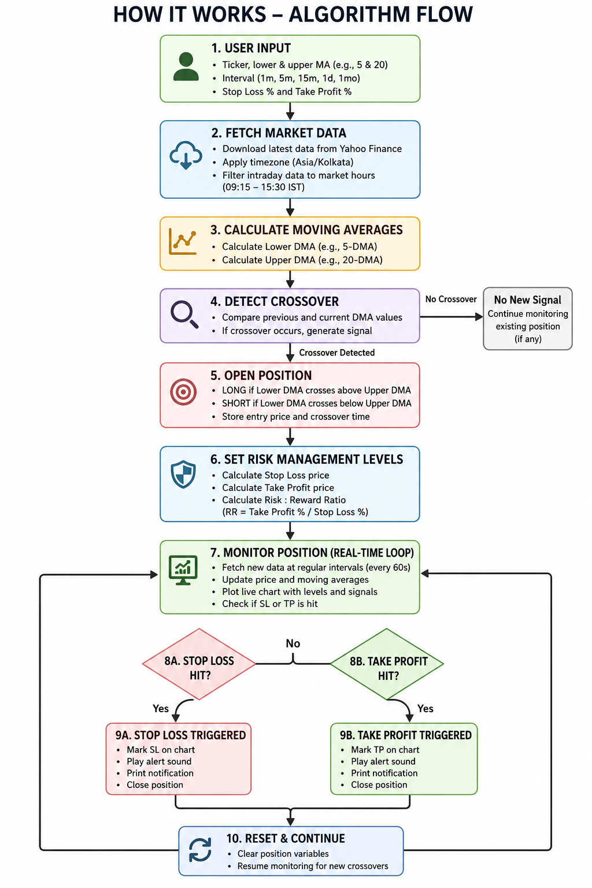
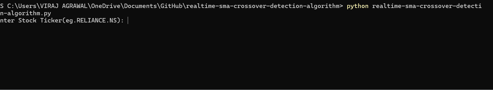
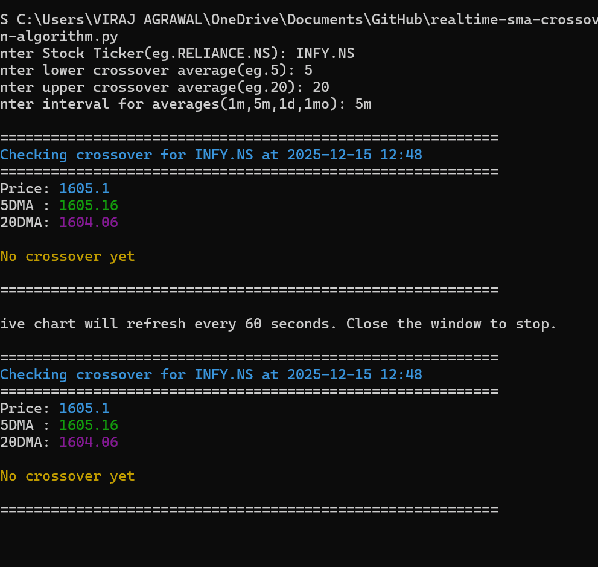
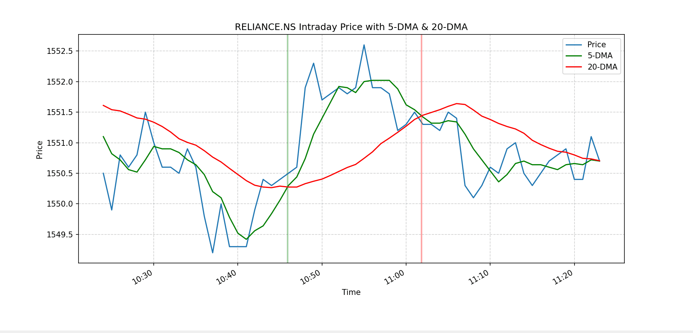
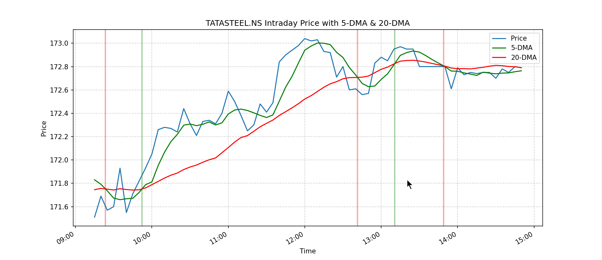
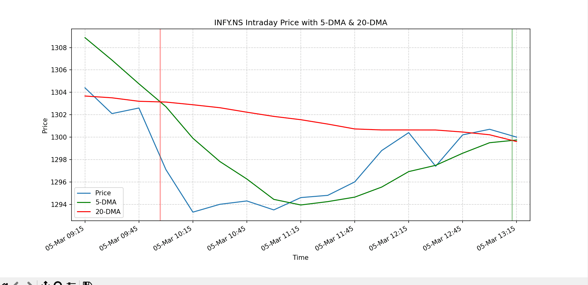

# Real-Time SMA Crossover Detection & Risk Management Algorithm
A Python-based real-time stock monitoring system that combines technical analysis, automated trade management, and live visualization. The application continuously streams market data from Yahoo Finance, detects Simple Moving Average (SMA) crossovers, opens simulated positions, calculates configurable Stop Loss and Take Profit levels, and monitors each position in real time until exit conditions are met.

Unlike a traditional SMA crossover detector, this project integrates risk management, state persistence, and live graphical monitoring, making it a more complete trading analysis system.

## Features:

### Market Data
1. Live market data using Yahoo Finance
2. Supports:
    * 1 Minute
    * 5 Minute
    * 15 Minute
    * Daily
    * Monthly intervals
3. Automatic handling of NSE trading hours (09:15–15:30 IST)
4. Automatic timezone conversion to Asia/Kolkata
   
### Technical Analysis
1. User-defined moving averages (e.g. 5 & 20 DMA)
2. Continuous SMA calculation
3. Bullish crossover detection
4. Bearish crossover detection
5. Dynamic crossover markers on the live chart
6. Console notifications with colour-coded output

### Position & Risk Management 
After every crossover the algorithm automatically:
* Opens a LONG or SHORT position
* Stores the entry price
* Calculates:
  * Stop Loss
  * Take Profit
  * Risk–Reward Ratio
* Continues monitoring the position even when no new crossover occurs
* Tracks the most recent signal until an exit condition is reached

The system therefore behaves more like a simplified trading engine rather than only a signal generator.

### Stop Loss & Take Profit Monitoring 

Once a position is active the algorithm continuously monitors:

* Stop Loss breach
* Take Profit hit

When either condition occurs it:

* Plays an audio alert
* Updates console status
* Highlights the event on the graph
* Risk–Reward Calculator (New)

The user specifies:

* Stop Loss %
* Take Profit %

The program automatically computes

Risk : Reward = Take Profit % / Stop Loss %

Example

`Stop Loss = 2%`

`Take Profit = 3%`

`Risk : Reward = 1 : 1.50`

The ratio is displayed whenever a new trade is opened and during live monitoring.

### Live Visualization

The live Matplotlib interface displays

* Price
* Lower SMA
* Higher SMA
* Bullish crossover markers
* Bearish crossover markers
* Current Stop Loss
* Current Take Profit

The graph refreshes every 60 seconds without restarting the program.

### Engineering Features
* Stateful position tracking
* Modular functions
* Dynamic graph updates using FuncAnimation
* Cross-platform audio alerts
* Robust exception handling
* Automatic recovery from API failures
* Adaptive plotting for intraday and long-term intervals
* Efficient rolling moving-average computation using pandas

## How It Works:

## USAGE

1. Create and activate a virtual environment.
   
2. Install dependencies: `pip install -r requirements.txt`
   
3. Run: `python realtime-sma-crossover-detection-algorithm.py`

### Example Input

## Example Output
### Console (Real-Time Updates):
FOR 5 MIN:

FOR 1 MONTH:

### Live Chart Example

Price + 5-DMA + 20-DMA with crossover markers.

FOR 1 MIN INTERVAL:

FOR 5 MIN INTERVAL:

FOR 15 MIN INTERVAL:

FOR 1 DAY INTERVAL:

FOR 1 MONTH INTERVAL:

## Technologies Used
Python

pandas

NumPy

yfinance

matplotlib

colorama

pytz

## Skills Demonstrated
Algorithm Design

Data Structures

State Management

Time-Series Analysis

Financial Data Processing

Data Visualization

Event-Driven Programming

Error Handling

Object-Oriented Design Principles

Software Engineering

## LICENSE:

  This project is licensed under the MIT License.
